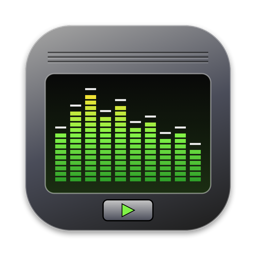
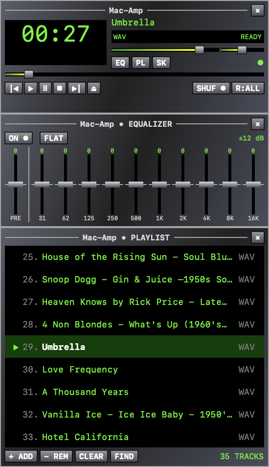
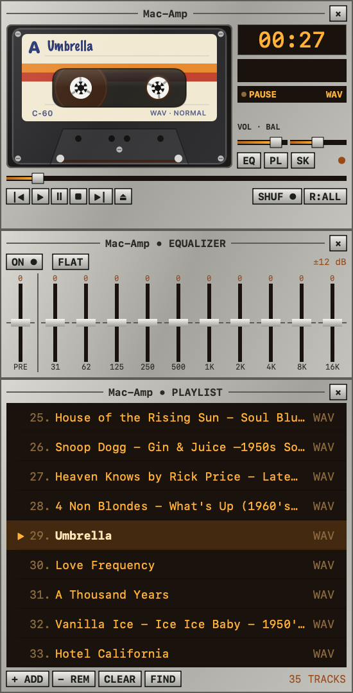
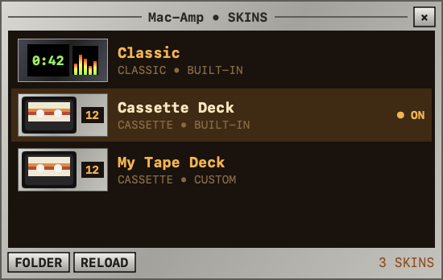

<p align="center"></p>

<h1 align="center">Mac-Amp</h1>

<p align="center">A native, offline Mac music player with the feel of a late-90s desktop player:<br>
three tiny snap-together windows, a spectrum analyzer, a ten-band equalizer and swappable skins.</p>

<p align="center">
  
  &nbsp;&nbsp;
  
</p>

Mac-Amp plays your local music files: no accounts, no streaming, no library import. Drop files or folders on it and press play. It's written in Swift with SwiftUI and AppKit, and uses [SFBAudioEngine](https://github.com/sbooth/SFBAudioEngine) for decoding.

> Mac-Amp is an independent project inspired by classic desktop players. It contains no Winamp code, artwork or skins and is not affiliated with Winamp.

## Contents

- [Features](#features)
- [Install and run](#install-and-run)
- [Using Mac-Amp](#using-mac-amp)
- [Skins](#skins)
- [Development](#development)
- [License](#license)

## Features

- **Three retro windows**: player, playlist and equalizer, at 1×, 2× or 3× size.
- **Magnetic docking**: drag the playlist or equalizer near any edge of another window and it snaps into place. Move the player and every attached window moves with it. Windows also snap to screen edges and never slide under the menu bar.
- **Formats**: WAV, MP3, FLAC, AAC/M4A, AIFF, Ogg Vorbis and Opus.
- **Spectrum analyzer** with the classic motion: bars jump on the beat, fall back smoothly, and peak markers hold for a moment before dropping.
- **Ten-band equalizer** (31 Hz–16 kHz) with preamp and automatic headroom, plus volume and balance.
- **Playlist** with drag-to-reorder, search (⌘F or J), shuffle without repeats, repeat off/all/one, and auto-scroll to the playing track.
- **Media keys and Control Center**: play/pause, next, previous and scrubbing from the keyboard or the Now Playing widget.
- **Skins**: Classic and a Cassette Deck skin whose tape reels turn while playing and wind from spool to spool as the song progresses. Make your own with a small JSON file.
- **Picks up where you left off**: queue, position, EQ, volume, skin and window layout are restored at launch, without auto-playing.
- **Private and light**: sandboxed with read-only access to the files you choose; uses about 0.2% CPU when idle.

## Install and run

There are no prebuilt downloads yet; you build the app from source. It takes a couple of minutes.

### Requirements

- A Mac with **Apple Silicon** (M1 or newer)
- **macOS 15** (Sequoia) or newer
- **Xcode 16** or newer, installed from the App Store and opened once so it can finish setting up

### Build the app

```bash
git clone https://github.com/allexcd/MacAmp.git
```

```bash
cd MacAmp
```

```bash
./scripts/build-app.sh
```

```bash
open dist/MacAmp.app
```

The first build downloads SFBAudioEngine and its codecs (pinned in `Package.resolved`); later builds work offline. The result, `dist/MacAmp.app`, is a self-contained app. Drag it into `/Applications` if you want to keep it.

The app is signed only for the Mac that built it. If you copy it to another Mac, macOS will warn that it's from an unidentified developer; right-click it and choose **Open** the first time.

### Run from Xcode

Open `MacAmp.xcodeproj`, pick the **MacAmp** scheme and press **Run** (⌘R). Xcode embeds and signs the codec frameworks for you.

## Using Mac-Amp

### Adding music

- Press **⌘O** or the **⏏** button and pick files or folders, or
- drag files or folders onto the player or playlist.

Folders are scanned recursively (hidden files and symlinks are skipped). Mac-Amp never copies, changes or deletes your audio files; removing a track only removes it from the queue.

### The windows

| Window | What it does |
|---|---|
| **Player** | Time display (click to switch elapsed/remaining), spectrum, title, volume and balance, seek bar, transport buttons, shuffle and repeat. **EQ**, **PL** and **SK** open the equalizer, playlist and skins panel. The × hides the app; click its Dock icon to bring it back. |
| **Playlist** | Double-click a track to play it. Drag rows to reorder, press Delete or **− REM** to remove, right-click for Play/Remove. **FIND** searches by title or artist. |
| **Equalizer** | Preamp plus ten bands of ±12 dB. **ON/OFF** bypasses it, **FLAT** resets every band. |
| **Skins** | Lists every skin with a preview; click one to switch. |

Drag any window by its title bar. Bring a panel within about 24 points of another window's edge and it snaps there; drag it away to detach it.

### Keyboard shortcuts

| Keys | Action |
|---|---|
| Space | Play / pause |
| ⌘. | Stop |
| ⌘[ / ⌘] | Previous / next track |
| ⌘O | Add files or folders |
| ⌘F or J | Search the playlist (Enter plays the first match, Esc closes) |
| ⌘L / ⌘E / ⌘K | Show or hide the playlist / equalizer / skins panel |
| ⌘1 / ⌘2 / ⌘3 | Original, double or triple size |
| ⌥⌘1, ⌥⌘2, … | Switch to skin 1, 2, … |
| ⌘0 | Bring back the player |
| ⌘M | Minimize the player |
| Media keys | Play/pause, next, previous |

### Where your settings live

Mac-Amp is sandboxed, so its data lives in its container:

```
~/Library/Containers/dev.macamp.prototype/Data/Library/Application Support/MacAmp/
├── session.json   queue, position, EQ, volume, skin, visibility
└── Skins/         your custom skins
```

Window positions are stored in the app's preferences. Delete the `MacAmp` folder to start fresh.

## Skins



Open the Skins panel with **SK** on the player (or **⌘K**) and click a skin to switch.

Two skins are built in:

- **Classic**: gunmetal panels and green phosphor display.
- **Cassette Deck**: a silver 70s tape deck with an amber counter. The cassette label shows the song title in handwriting, and the reels turn at a realistic speed as the tape winds across.

### Make your own

1. In the Skins panel, press **FOLDER**. This opens your skins folder and creates `README.txt` and `Example.json` there.
2. Copy `Example.json`, give it a new `"name"`, and change any colors.
3. Press **RELOAD** in the panel, then click your skin.

A skin is a JSON file. Colors are `#RRGGBB` or `#RRGGBBAA` (with transparency):

```json
{
  "name": "Midnight Tape",
  "face": "cassette",
  "basedOn": "cassette",
  "colors": {
    "display": "#6FD3FF",
    "displayBackground": "#05080C",
    "panelTop": "#3A3F47",
    "panelMid": "#15171B",
    "panelBottom": "#2B2F36",
    "cassetteShell": "#3F9BDDB8",
    "cassetteStripe1": "#2E5BFF",
    "cassetteStripe2": "#B23CFF"
  }
}
```

- `face` picks the player layout: `classic` or `cassette`.
- `basedOn` (optional) names a skin to inherit from. Any color you leave out comes from it, then from Classic, so a skin can be just a few lines.
- Broken files are skipped, so a typo never breaks the app.

<details>
<summary><b>All color tokens</b></summary>

| Token | Paints |
|---|---|
| `display` | LCD text, spectrum base, playlist titles |
| `displayBackground` | LCD, playlist and slider backgrounds |
| `displayDim` | secondary LCD text (track numbers, formats) |
| `displayHighlight` | the playing track's title, peak markers |
| `playingRow` | background of the playing playlist row |
| `panelTop`, `panelMid`, `panelBottom` | window body gradient |
| `border` | window outline and title-bar lines |
| `text` | window titles and labels |
| `panelAccent` | highlighted labels on the window body (EQ values, track count) |
| `buttonTop`, `buttonBottom`, `buttonPressed`, `buttonText` | buttons |
| `sliderFillStart`, `sliderFillEnd`, `knob` | sliders and faders |
| `spectrumHigh`, `spectrumMid` | spectrum bar colors (top, middle) |
| `cassetteShell`, `cassetteLabel`, `cassetteStripe1`, `cassetteStripe2`, `cassetteInk` | cassette body, label, stripes, handwriting |
| `tape`, `reel`, `deck` | tape packs, reel hubs, tape-well background |

</details>

<br clear="right">

## Development

### Project layout

```
Sources/
  MacAmpCore/          Pure logic, no UI (unit-tested)
    Session.swift        Saved state, queue, shuffle/repeat decisions, JSON persistence
    WindowDocking.swift  Snapping and "which windows are attached" math
    Skin.swift           Skin format, built-in skins, loading and inheritance
  MacAmp/              The app
    App.swift            Windows (creation, dragging, docking), menus, app delegate
    Model.swift          Observable app state, playback control, import, Now Playing
    Playback.swift       Audio engine, equalizer, spectrum analysis
    Views.swift          Player, playlist and equalizer views, shared controls
    Cassette.swift       The cassette player face and its animated tape
    SkinsPanel.swift     The Skins window
    Theme.swift          Turns a skin into SwiftUI colors (the "palette")
Tests/                 Unit and playback tests
scripts/               Build, packaging, fixtures, project and icon generation
Config/                Info.plist, entitlements, app icon
```

### How it fits together

- Each window is a borderless `NSWindow` hosting a SwiftUI view. `Windows` in `App.swift` moves windows itself on title-bar drags. That's what lets attached panels follow every mouse step and snap live.
- `Model` is the single source of truth. Values that change many times a second (position, play state) live in a separate `LiveState` object that only the player watches, so the playlist and equalizer don't redraw on every tick.
- `Playback` wraps SFBAudioEngine's `AudioPlayer`, inserts an `AVAudioUnitEQ`, and taps the output for the spectrum. Analysis runs off the main thread, and its frames are released in step with the audio so the bars animate smoothly at 60 fps.
- Skins flow through the SwiftUI environment as a `Palette`; views ask it for colors by name instead of hard-coding them.

### Build and test from the command line

```bash
swift build
```

The tests decode and play short generated tones, so create those first (needs [ffmpeg](https://ffmpeg.org), e.g. `brew install ffmpeg`):

```bash
./scripts/generate-fixtures.sh
```

```bash
swift test
```

Playback tests briefly play quiet tones and need an audio output device; they and the codec tests rely on the fixtures above.

`swift run` works for quick UI iteration, but it runs unsandboxed and without the app bundle (generic Dock icon, settings stored outside the sandbox container). Use `./scripts/build-app.sh` or Xcode to try the real app.

### Handy scripts

| Script | Use it when |
|---|---|
| `scripts/build-app.sh` | Building `dist/MacAmp.app` (release build, codec frameworks embedded, licenses copied, signed). |
| `scripts/generate-project.py` | **You add or remove a source file.** The Xcode project lists files explicitly and is generated from the `Sources/` folders. |
| `scripts/make-icon.swift` | Changing the app icon. It draws the icon in code and writes `Config/AppIcon.icns`: `swift scripts/make-icon.swift`. |
| `scripts/generate-fixtures.sh` | Creating the test audio files. |

### Good first changes

- **A new built-in skin**: add a `Skin` next to `Skin.cassette` in `Sources/MacAmpCore/Skin.swift` and include it in `Skin.builtIn`.
- **A new player face**: add a case to `Skin.Face`, a view like `CassetteFace`, and a branch in `PlayerView`. Set its height in `Windows.playerHeight`.
- **A new window**: add a case to `Windows.Panel`, its size in `update(_:)`, and its view; docking and snapping come for free.

### Not done yet

Named playlists, M3U import/export, library indexing, streaming, Winamp `.wsz` skins, guaranteed gapless playback, and automatic updates. Testing has been on recent macOS; macOS 15, other output devices, and VoiceOver need more checking.

## License

Mac-Amp's own code is released under the [MIT License](LICENSE).

It depends on SFBAudioEngine (MIT) and the audio codecs it bundles. Several of those are licensed under the LGPL or other terms (LAME, mpg123, libsndfile, Musepack, TTA, TagLib, Monkey's Audio). Their notices are in [`Licenses/`](Licenses) and [`THIRD_PARTY_NOTICES.md`](THIRD_PARTY_NOTICES.md). If you distribute built copies of the app, review those terms first; the collected notices alone don't satisfy every obligation.
